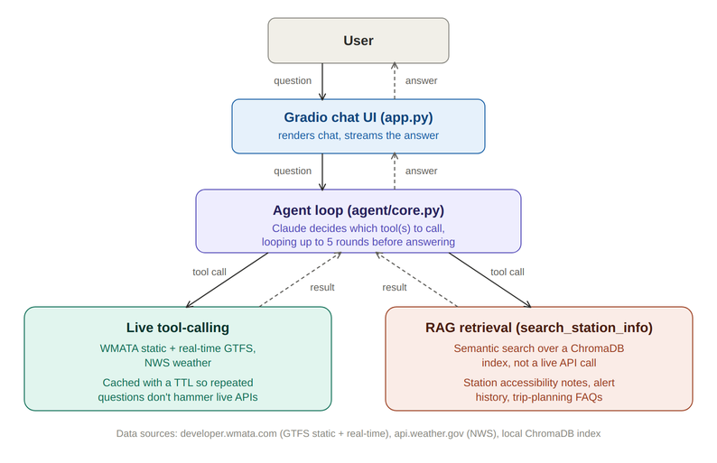

# DC Metro Transit Assistant 🚇

A conversational assistant for DC-area Metrorail (WMATA) — ask about schedules, live
arrivals, service alerts, station accessibility, and weather in plain English.

Built as a hackathon project for Coding It Forward. The architecture is hybrid
tool-calling + RAG: time-sensitive data (schedules, live arrivals, alerts, weather) is
answered via live tool calls, while descriptive/semi-static content (station
accessibility notes, FAQs) is answered via semantic retrieval over a ChromaDB index.
See [CLAUDE.md](CLAUDE.md) for the full architecture rationale and
[DECISIONS.md](DECISIONS.md) for a log of notable design decisions.

## Architecture  



## Demo

A live demo on Hugging Face Spaces is private. To request access, open an [issue on this repo](https://github.com/ahennessy25/dc-metro-transit-assistant/issues) requesting access.

## Features

- **Live arrivals** — real-time train predictions for any station (WMATA GTFS-Realtime)
- **Service alerts** — active disruptions and delays, by line
- **Scheduled times** — static timetable lookups (WMATA GTFS Static)
- **Weather** — current conditions and forecast (National Weather Service, no key needed)
- **Station info** — accessibility and FAQ lookups via retrieval (ChromaDB)
- Handles ambiguous station names by asking a clarifying question or stating an
  assumption, rather than silently guessing

## Data sources

Station accessibility info (`data/rag_sources/compile_sources.py`) comes from WMATA's
Rail Station List and Station Entrances APIs. An entrance is flagged as having an
elevator by a simple keyword match — "elevator" appearing (case-insensitive) in that
entrance's `Name` or `Description` field, exactly as WMATA wrote it — not by inferring
accessibility from station type or any other signal. This is a literal-text match, not
a judgment of current status: a description that happens to pair "elevator" with a
negation/outage word (e.g. "elevator closed for construction") would still match today;
`find_ambiguous_elevator_entrances()` flags any such cases for manual review each time
the data is refreshed.

## Setup

### Prerequisites

- Python 3.10+
- An [Anthropic API key](https://console.anthropic.com/) (with available credit —
  the app will show a clear in-UI error if the key is missing or the account is
  out of credits)
- A free [WMATA API key](https://developer.wmata.com/) for live transit data

### Install

```bash
python -m venv venv
source venv/bin/activate  # Windows: venv\Scripts\activate
pip install -r requirements.txt
```

### Configure

```bash
cp .env.example .env
```

Then fill in `.env`:

```
ANTHROPIC_API_KEY=your-anthropic-key
WMATA_API_KEY=your-wmata-key
```

`.env` is gitignored — never commit real keys, and there are no hardcoded key
fallbacks anywhere in the codebase (`config.py` reads exclusively from environment
variables, and `data/wmata_static.py` / `data/wmata_realtime.py` raise a clear error
rather than silently falling back to a default if `WMATA_API_KEY` is missing).

### Run

```bash
python app.py
```

Opens a Gradio chat UI on `http://127.0.0.1:7860`. If `ANTHROPIC_API_KEY` isn't set,
the UI shows a banner explaining that rather than failing silently or crashing.

### Deploying (Hugging Face Spaces)

Set `ANTHROPIC_API_KEY` and `WMATA_API_KEY` under your Space's **Settings →
Repository secrets** — do not commit them to the repo or hardcode them in source.

## Tests

```bash
pytest
```

Unit tests cover the GTFS/weather parsing logic (mocked HTTP), the agent's
tool-dispatch loop (mocked Anthropic client — no live API calls), and the Gradio
UI's input-handling/error-formatting logic.

## Verification harness

```bash
python -m agent.verification_harness
```

Runs a fixed set of test questions through the live agent and checks whether tool
routing matches expectations (does asking about live arrivals call
`get_real_time_arrivals`, does an ambiguous station name avoid silently guessing,
etc.). Requires a working `ANTHROPIC_API_KEY` with available credit — this makes
real API calls. Results are logged to `agent/verification_results.log`.

## Project structure

```
agent/        agent loop, tool schemas/dispatch, verification harness
data/         GTFS static/realtime parsing, weather, RAG index, caching
eval/         answer-quality evaluation question sets
tests/        pytest unit tests (mocked external calls)
app.py        Gradio chat UI
config.py     environment/config loading
```
